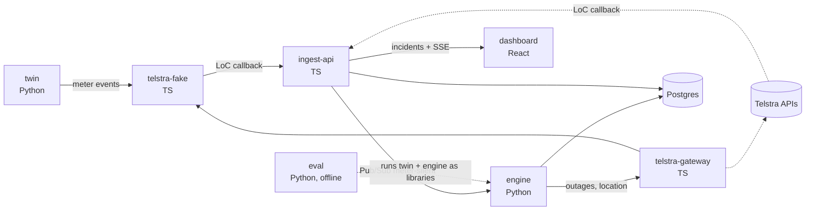

# 4-pillars

Electricity distributors rely on smart meters to spot power outages, but when meters stop reporting they can't easily tell whether the power is out, the mobile network is down, or a meter has failed. Guessing wrong sends crews to the wrong places and slows down restoring power. We want to help distributors make that call within minutes.

Team 4 Pillars · Telstra IoT Fest 2026 · Theme 3, Disaster Management & Resilience

## How it works

1. **Signal.** Every meter has a Telstra SIM. When one drops off the network, Telstra's Loss of Connectivity API calls us with the phone number, a reason code and the time.
2. **Insight.** The engine groups silent meters that went quiet together and checks them against the power grid (which transformer feeds them) and against Telstra's Network Availability API (is there a network outage in that suburb, and where).
3. **Decision.** It scores four causes (power outage, network outage, meter fault, tamper) and picks the action with the lowest expected cost. Below 60% confidence it asks a human.
4. **Action.** The dashboard shows each incident on a map with the verdict, the evidence behind it and the money saved compared with sending a crew every time.

We can't get 2,000 real meters, so a **digital twin** of a grid and mobile network on real Melbourne suburbs plays them. It injects faults with a known true cause, so we can measure how often the engine is right.

## Architecture



On Google Cloud each service runs on Cloud Run, ingest-api → engine goes over Pub/Sub, secrets live in Secret Manager, Postgres is Cloud SQL, and the dashboard is on Firebase Hosting. Locally, Docker Compose runs all of it offline.

| Service | Language | Port | What it does |
|---|---|---|---|
| [ingest-api](services/ingest-api) | TypeScript, Fastify | 8081 | Receives LoC callbacks, stores events, serves incidents to the dashboard |
| [telstra-gateway](services/telstra-gateway) | TypeScript, Fastify | 8082 | The only thing that calls Telstra: auth, headers, retries, caching |
| [telstra-fake](services/telstra-fake) | TypeScript, Fastify | 8083 | Our stand-in for the three Telstra APIs, built from the public docs |
| [engine](services/engine) | Python, FastAPI | 8084 | Clusters silent meters, scores causes, picks an action, explains why |
| [twin](services/twin) | Python, FastAPI | 8085 | Digital twin: grid, network, meters, fault injection, ground truth |
| [dashboard](apps/dashboard) | React, TypeScript, Vite | 5173 dev / 3000 in Compose | Map, verdicts, evidence, scenario controls |
| [eval](eval) | Python | offline | Seeded batch runs, baselines, metrics, ablations |

Shared request and response schemas for the Telstra APIs and our own events are in [packages/contracts](packages/contracts) (TypeScript) and [engine/contracts.py](services/engine/src/engine/contracts.py) (Python). Notes on the Telstra APIs are in [docs/telstra-apis.md](docs/telstra-apis.md).

## Getting started

You need Node 22+, [uv](https://docs.astral.sh/uv/) and Docker.

Run everything:

```bash
docker compose up --build
```

Then check http://localhost:8081/health (and 8082 to 8085), and open the dashboard at http://localhost:3000.

Work on one TypeScript service:

```bash
npm install
npm run dev -w @4p/ingest-api
npm test -w @4p/ingest-api
```

Work on one Python service:

```bash
cd services/engine
uv sync
uv run pytest
uv run uvicorn engine.main:app --reload --port 8084
```

Before pushing:

```bash
npm run lint && npm run typecheck && npm test
```

For Python, run `uv run ruff check . && uv run pytest` in the folder you changed. CI runs all of this plus `docker compose up` on every PR.

## New service?

Copy [templates/fastify-service](templates/fastify-service) or [templates/fastapi-service](templates/fastapi-service). Both come with `/health`, JSON logs that Cloud Logging understands, settings from env vars and a test.

## Rules

- Never commit Telstra credentials or GCP keys. Use `.env` locally (it's gitignored) and Secret Manager in the cloud.
- Build only from Telstra's **public** docs on dev.telstra.com.
- Work on a branch, open a PR, and reference the issue (`Closes #12`). Tasks are on the [project board](https://github.com/users/Shrishagwl/projects/2).
